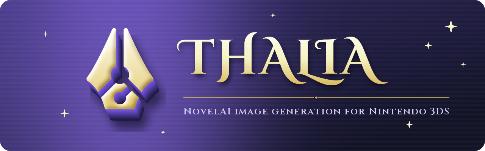
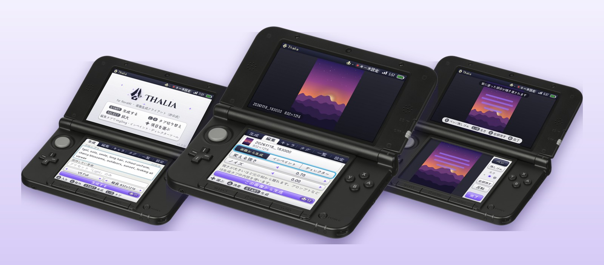
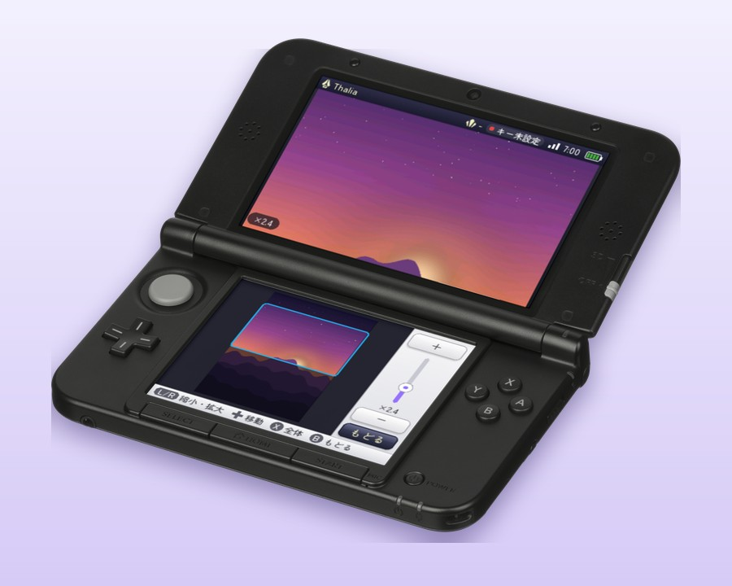
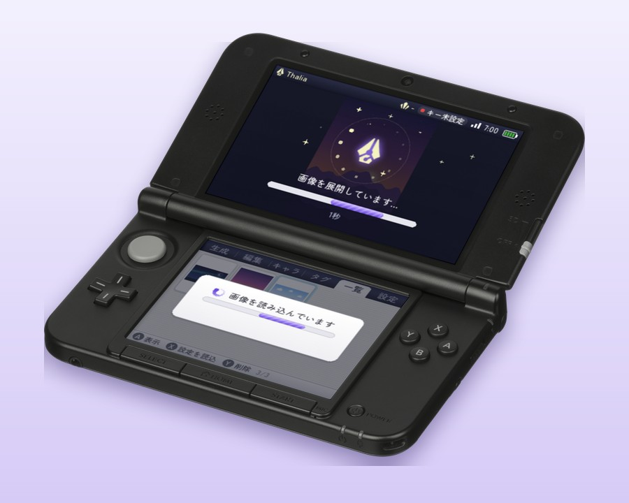
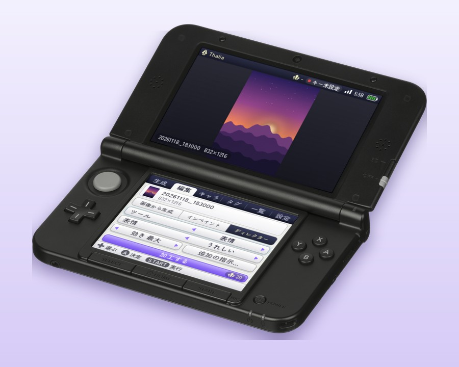
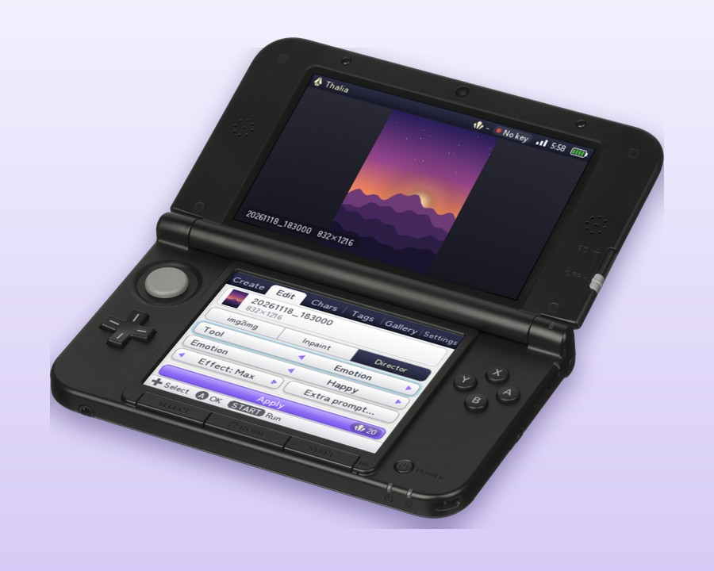

<div align="center">

<a href="README.md"></a>
<a href="README.en.md"></a>



### NovelAI image generation, on your 3DS.

An unofficial homebrew app that talks to NovelAI directly from the Nintendo 3DS.<br>
No relay server, no phone, no PC.

[](https://github.com/Tesixki/thalia/actions/workflows/build.yml)
[](https://github.com/Tesixki/thalia/releases/latest)
[](COPYING.LESSER)
[](#install)

</div>

<br>

<p align="center">
  
</p>

Bug reports and feature requests are welcome in [Issues](https://github.com/Tesixki/thalia/issues).

## Features

- **3DS only** — connects to the NovelAI API over HTTPS straight from the console
- **Create and edit** — text-to-image, img2img, touch-screen inpainting, and Director Tools (line art, sketch, background removal, declutter, colorize, emotion)
- **Anlas at a glance** — your balance and V5 allowance are always on screen, with a cost estimate before every request
- **Models and settings** — 9 models from V3 to V5, character prompts (up to 6), sampler, seed, quality tags and more
- **Tag search** — Danbooru tag suggestions, including Japanese-to-English lookup
- **Fast gallery and zoom viewer** — a 3DS-sized copy of each image is cached, so images open instantly the second time; zoom and pan from the bottom screen
- **Lighter downloads** — set Image Format to WebP to receive lossless WebP, about 30% less data than PNG
- **Feels like a 3DS app** — D-pad and touch controls, Japanese and English UI

## Install

<table>
  <tr>
    <td width="210" align="center">
      
    </td>
    <td>
      <b>Scan with FBI (recommended)</b>
      <ol>
        <li>Open <a href="https://github.com/lifehackerhansol/FBI/releases">FBI</a> and choose <b>Remote Install</b> → <b>Scan QR Code</b></li>
        <li>Scan the QR code on the left</li>
        <li>Thalia appears on the HOME Menu</li>
      </ol>
    </td>
  </tr>
</table>

To use the Homebrew Launcher instead, download `thalia.3dsx` from [Releases](https://github.com/Tesixki/thalia/releases/latest) and put it in `/3ds/` on your SD card.

**Requirements**

- A 3DS / New 3DS with custom firmware ([Luma3DS](https://github.com/LumaTeam/Luma3DS))
- A NovelAI subscription
- Correct date and time on the console (HTTPS fails otherwise)

## Getting started

1. Run Thalia once. It creates `/3ds/thalia/config.ini` on the SD card
2. On the NovelAI website, open **Settings → Account → Get Persistent API Token** and copy the token (it starts with `pst-`)
3. Paste it after `api_key=` in `config.ini` and save (you can also type it in the Settings tab on the 3DS)
4. When the status bar shows **Key OK**, you are ready. Enter a prompt and press <kbd>START</kbd>

> [!WARNING]
> The API key is stored as plain text on the SD card. Delete `config.ini` before lending your SD card to anyone.

## Usage

Switch tabs on the bottom screen with <kbd>L</kbd> <kbd>R</kbd> or by touch.

| Tab | What it does |
| --- | --- |
| Create | Enter the prompt and undesired content, then generate |
| Edit | Rework the image on the top screen with img2img, inpainting or Director Tools |
| Chars | Per-character prompts and positions (V4 and later) |
| Tags | Search Danbooru tags and add them to the prompt; save the ones you use often |
| Gallery | Browse generated images; press <kbd>A</kbd> again on the shown image to open the zoom viewer; load the settings that made an image |
| Settings | Model, size, steps and other options, image format (PNG / WebP), API key, language |

| Button | Action |
| --- | --- |
| <kbd>✚</kbd> | Move the cursor (left / right changes values) |
| <kbd>A</kbd> | Confirm, enter text |
| <kbd>START</kbd> | Generate (on the Edit tab, run the selected edit) |
| <kbd>SELECT</kbd> | Open the zoom viewer (drag the overview on the bottom screen to pan; <kbd>L</kbd> <kbd>R</kbd> or the slider to zoom) |
| <kbd>B</kbd> | Cancel the request |

Images are saved at full resolution to `/3ds/thalia/images/` (as `.png` or `.webp`, depending on the image format), together with a 3DS-sized copy (`.vw`) used by the gallery.

## Screenshots

| Zoom viewer | Generating |
| :---: | :---: |
|  |  |
| **Director Tools** | **English UI** |
|  |  |

<sub>Captured on the Azahar emulator and placed into a photo of a 3DS XL. The landscapes are sample images, not AI-generated results.</sub>

## FAQ

<details>
<summary><b>"Cannot verify the server certificate"</b></summary>
<br>

The console clock is probably off. Set the correct date and time in System Settings.
Turning off "Verify TLS" in Settings may let you connect, but it no longer checks who you are talking to and can leak your API key, so it is not recommended.

</details>

<details>
<summary><b>How is the Anlas cost calculated?</b></summary>
<br>

The number on the run button is an <b>estimate</b> based on image size, steps and strength, using the formula the <a href="https://github.com/caru-ini/novelai-sdk">unofficial SDK</a> derived from the NovelAI website.
Requests inside the Opus free tier show "Free". Once the V5 allowance (Opus only) runs out, V5 models cost Anlas even on Opus.

</details>

<details>
<summary><b>Why is it slow?</b></summary>
<br>

Generation on NovelAI takes a few to tens of seconds, then the 3DS needs a few seconds to decode the image (longer on the original 3DS).
img2img and inpainting also have to upload the source image.

</details>

## Development

```sh
docker run --rm -v "$PWD:/src" -w /src devkitpro/devkitarm:latest make
```

See [docs/DEVELOPMENT.md](docs/DEVELOPMENT.md) (Japanese) for building, releasing, testing and the source layout.
The NovelAI API can change without notice. If something breaks, please open an [issue](https://github.com/Tesixki/thalia/issues).

## License

[LGPL-3.0](COPYING.LESSER) (the GPL v3 text it builds on is in [COPYING](COPYING)).

Bundled third-party files keep their own licenses:

- [Zen Maru Gothic](https://fonts.google.com/specimen/Zen+Maru+Gothic) — SIL Open Font License 1.1 ([fonts/OFL.txt](fonts/OFL.txt))
- [Cinzel](https://fonts.google.com/specimen/Cinzel) / [Cinzel Decorative](https://fonts.google.com/specimen/Cinzel+Decorative) — SIL Open Font License 1.1 ([fonts/OFL-Cinzel.txt](fonts/OFL-Cinzel.txt), [fonts/OFL-CinzelDecorative.txt](fonts/OFL-CinzelDecorative.txt))
- [stb_image](https://github.com/nothings/stb) — Public Domain / MIT
- [libwebp](https://chromium.googlesource.com/webm/libwebp) (decoder only, `third_party/libwebp`) — BSD 3-Clause ([COPYING](third_party/libwebp/COPYING), [PATENTS](third_party/libwebp/PATENTS))
- Root certificates (`romfs/cacert.pem`) — Mozilla Public License 2.0
- 3DS XL photo in the README — [Evan-Amos](https://commons.wikimedia.org/wiki/File:Nintendo-3DS-XL-angled.png) (public domain)

<br>

<sub>Thalia is not affiliated with NovelAI / Anlatan or Nintendo. Nintendo 3DS is a trademark of Nintendo. The NovelAI logo and the Anlas icon are trademarks or works of NovelAI / Anlatan and are not covered by the LGPL.</sub>
