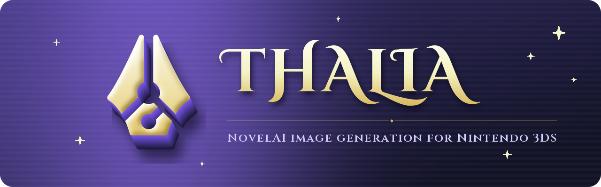
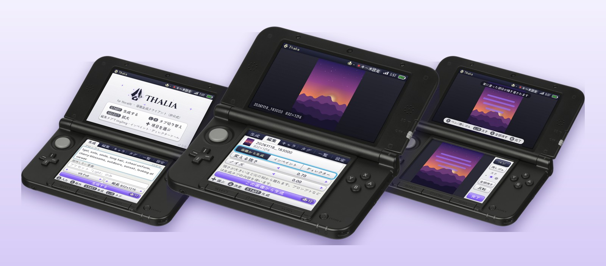
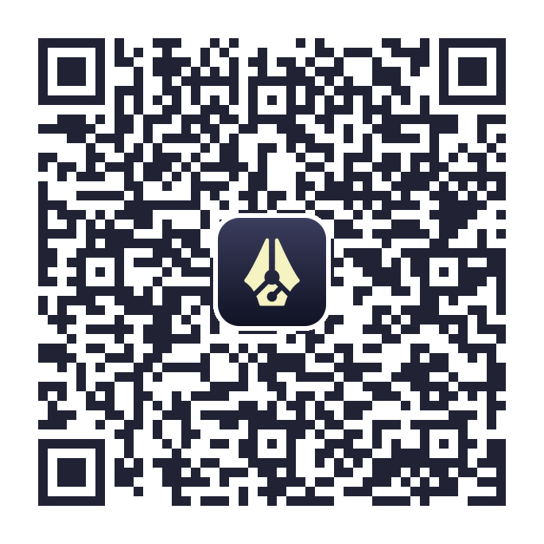
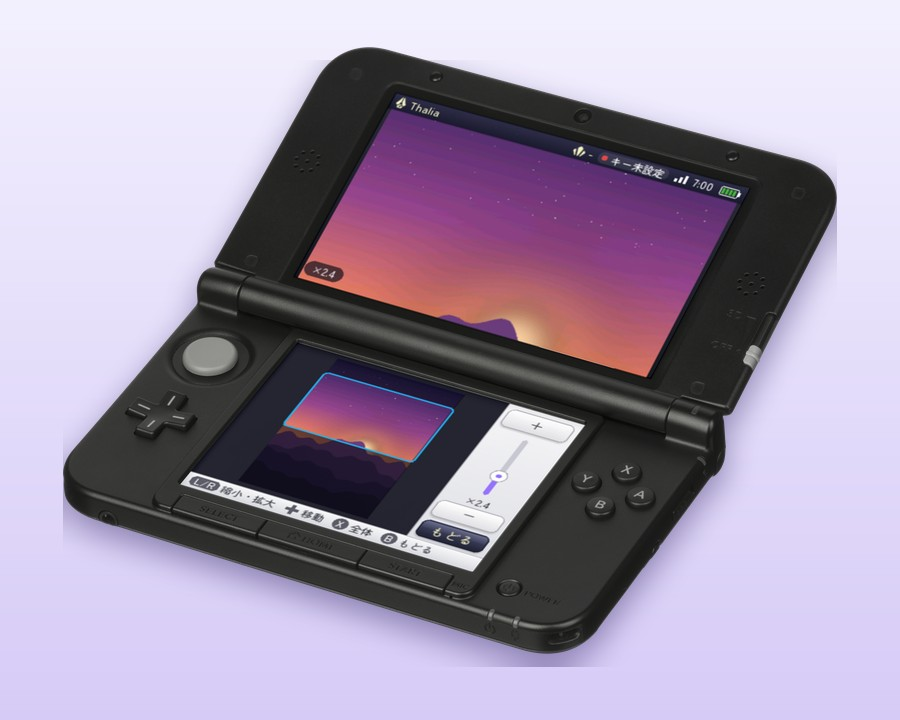
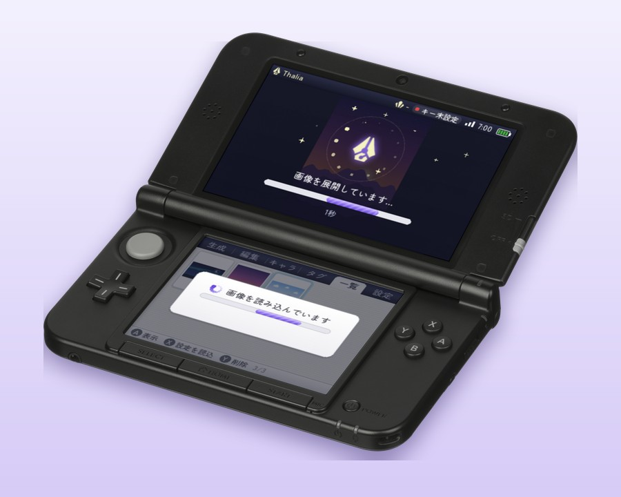
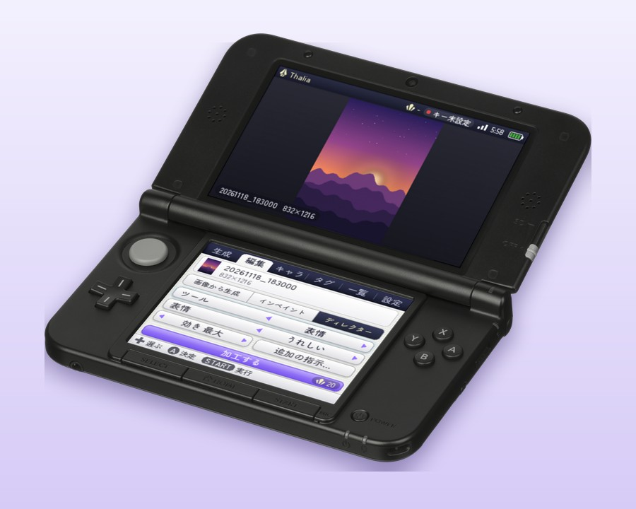
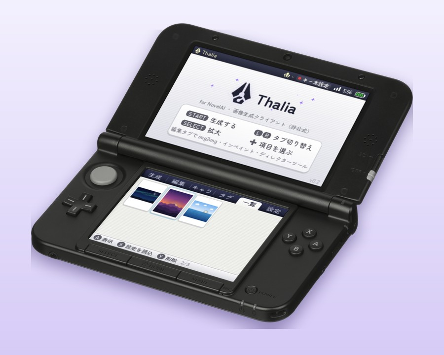

<div align="center">

<a href="README.md"></a>
<a href="README.en.md"></a>



### NovelAI の画像生成を、3DS で。

中継サーバーを使わず、3DS から NovelAI に直接つないで画像を生成する<br>
非公式のホームブリューアプリです。

[](https://github.com/Tesixki/thalia/actions/workflows/build.yml)
[](https://github.com/Tesixki/thalia/releases/latest)
[](COPYING.LESSER)
[](#インストール)

</div>

<br>

<p align="center">
  
</p>

不具合や機能追加の要望なら、[Issue](https://github.com/Tesixki/thalia/issues) で教えてください。

## 特長

- **3DS だけで完結** — PC やスマホを介さず、3DS から NovelAI の API に HTTPS で直接つなぎます
- **生成も編集も** — 通常の生成に加えて、img2img、タッチペンで塗るインペイント、ディレクターツール（線画・ラフ・背景除去・文字消し・色付け・表情）
- **Anlas がひと目で分かる** — 残高と V5 の残量を常に表示し、実行する前に必要な Anlas の目安を出します
- **モデルと設定をひと通り** — V3〜V5 の 9 モデル、キャラ別プロンプト（最大 6 人）、サンプラー・シード・品質タグなど
- **タグ検索** — Danbooru タグの候補を検索。日本語で入力すると英語のタグが見つかります
- **すぐ開ける一覧と拡大ビューア** — 3DS 向けに縮小した画像を保存しておくので、2 回目からはすぐに開けます。拡大は下画面の縮図をなぞって操作します
- **軽い通信** — 設定の「受信形式」を WebP にすると、画質はそのまま（可逆）で通信量が約 3 割減ります
- **3DS らしい操作感** — 十字キーでもタッチでも操作でき、日本語と英語の表示に対応

## インストール

<table>
  <tr>
    <td width="210" align="center">
      
    </td>
    <td>
      <b>FBI で QR コードを読み取る（おすすめ）</b>
      <ol>
        <li><a href="https://github.com/lifehackerhansol/FBI/releases">FBI</a> を起動して <b>Remote Install</b> → <b>Scan QR Code</b> を選ぶ</li>
        <li>左の QR コードを 3DS のカメラで読み取る</li>
        <li>インストールが終わると、HOME メニューに Thalia が並びます</li>
      </ol>
    </td>
  </tr>
</table>

Homebrew Launcher から使う場合は、[Releases](https://github.com/Tesixki/thalia/releases/latest) から `thalia.3dsx` をダウンロードして、SD カードの `/3ds/` に置いてください。

**必要なもの**

- カスタムファームウェア（[Luma3DS](https://github.com/LumaTeam/Luma3DS)）を導入した 3DS / New 3DS
- NovelAI のサブスクリプション
- 正しい日付と時刻（ずれていると HTTPS の接続に失敗します）

## はじめかた

1. Thalia を一度起動すると、SD カードに `/3ds/thalia/config.ini` が作られます
2. NovelAI の Web で **Settings → Account → Get Persistent API Token** を開き、`pst-` で始まるトークンをコピーします
3. `config.ini` の `api_key=` の後ろに貼り付けて保存します（3DS の設定タブから入力することもできます）
4. 上画面の右上に **キーOK** と出たら準備完了です。プロンプトを入れて <kbd>START</kbd> で生成します

> [!WARNING]
> API キーは SD カードに平文で保存されます。SD カードを人に渡すときは `config.ini` を削除してください。

## 使い方

下画面のタブを <kbd>L</kbd> <kbd>R</kbd> かタッチで切り替えます。

| タブ | できること |
| --- | --- |
| 生成 | プロンプトと除外したい要素を入力して生成する |
| 編集 | 表示中の画像を img2img・インペイント・ディレクターツールで加工する |
| キャラ | キャラクターごとのプロンプトと、画面内の位置を決める（V4 以降） |
| タグ | Danbooru タグを検索して、プロンプトに追加する。よく使うタグは保管できる |
| 一覧 | 生成した画像を見る。表示中の画像でもう一度 <kbd>A</kbd> を押すと拡大ビューア。その画像を作ったときの設定も読み込める |
| 設定 | モデル・サイズ・ステップ数などの詳しい設定、受信形式（PNG / WebP）、API キー、表示言語 |

| ボタン | はたらき |
| --- | --- |
| <kbd>✚</kbd> | 項目を選ぶ（左右で値を変える） |
| <kbd>A</kbd> | 決定・文字の入力 |
| <kbd>START</kbd> | 生成（編集タブでは選んでいる加工を実行） |
| <kbd>SELECT</kbd> | 拡大ビューアを開く（下画面の縮図をなぞって移動、<kbd>L</kbd> <kbd>R</kbd> かスライダーで拡大・縮小） |
| <kbd>B</kbd> | 通信をキャンセル |

生成した画像は `/3ds/thalia/images/` に元の解像度のまま（受信形式に合わせて `.png` か `.webp` で）保存されます。あわせて 3DS 表示用に縮小した画像（`.vw`）も保存し、一覧から開くときに使います。

## スクリーンショット

| 拡大ビューア | 生成中 |
| :---: | :---: |
|  |  |
| **ディレクターツール** | **一覧** |
|  |  |

<sub>画面はエミュレータ（Azahar）で撮影し、3DS LL の写真にはめこみました。写っている風景は見本用の画像で、AI による生成結果ではありません。</sub>

## よくある質問

<details>
<summary><b>「サーバー証明書を確認できません」と出る</b></summary>
<br>

本体の日付と時刻がずれていると、HTTPS の証明書の確認に失敗します。本体設定で時計を合わせてください。
設定タブの「証明書の検証」を OFF にすると接続できることがありますが、通信相手を確かめなくなり API キーが漏れるおそれがあるため、おすすめしません。

</details>

<details>
<summary><b>生成に必要な Anlas はどう決まる？</b></summary>
<br>

実行ボタンに出る数字は、画像の大きさ・ステップ数・強さから計算した**目安**です（[非公式 SDK](https://github.com/caru-ini/novelai-sdk) が NovelAI の Web 画面から推定した計算式を使っています）。
Opus の無料枠に入る設定なら「無料」と表示されます。V5 の残量（Opus のみ）を使い切ると、V5 のモデルは Opus でも Anlas がかかります。

</details>

<details>
<summary><b>生成に時間がかかる</b></summary>
<br>

NovelAI 側の生成に数秒〜数十秒、そのあと 3DS で画像を展開するのに数秒かかります。旧 3DS では展開がさらに遅くなります。
img2img とインペイントは、元の画像を送る時間もかかります。

</details>

<details>
<summary><b>名前の由来は？</b></summary>
<br>

NovelAI のモデル名（Calliope、Clio、Erato、Euterpe）と同じギリシャ神話の詩神、タレイア（Thalia）から取りました。

</details>

## 開発

```sh
docker run --rm -v "$PWD:/src" -w /src devkitpro/devkitarm:latest make
```

ビルド方法、配布の手順、テスト、ソースの構成は [docs/DEVELOPMENT.md](docs/DEVELOPMENT.md) にまとめています。
NovelAI の API は予告なく変わることがあります。動かなくなったら [Issue](https://github.com/Tesixki/thalia/issues) で教えてください。

## ライセンス

[LGPL-3.0](COPYING.LESSER)（土台となる GPL v3 の条文は [COPYING](COPYING)）

同梱している次のものは、それぞれのライセンスに従います。

- [Zen Maru Gothic](https://fonts.google.com/specimen/Zen+Maru+Gothic) — SIL Open Font License 1.1（[fonts/OFL.txt](fonts/OFL.txt)）
- [Cinzel](https://fonts.google.com/specimen/Cinzel) / [Cinzel Decorative](https://fonts.google.com/specimen/Cinzel+Decorative) — SIL Open Font License 1.1（[fonts/OFL-Cinzel.txt](fonts/OFL-Cinzel.txt)、[fonts/OFL-CinzelDecorative.txt](fonts/OFL-CinzelDecorative.txt)）
- [stb_image](https://github.com/nothings/stb) — パブリックドメイン / MIT
- [libwebp](https://chromium.googlesource.com/webm/libwebp)（展開部分のみ、`third_party/libwebp`）— BSD 3-Clause（[COPYING](third_party/libwebp/COPYING)、[PATENTS](third_party/libwebp/PATENTS)）
- ルート証明書（`romfs/cacert.pem`）— Mozilla Public License 2.0
- README の 3DS LL の写真 — [Evan-Amos](https://commons.wikimedia.org/wiki/File:Nintendo-3DS-XL-angled.png)（パブリックドメイン）

<br>

<sub>Thalia は NovelAI / Anlatan とも任天堂とも関係のない非公式アプリです。ニンテンドー3DS は任天堂の商標です。NovelAI のロゴと Anlas アイコンは NovelAI / Anlatan の商標・著作物で、LGPL の対象ではありません。</sub>
